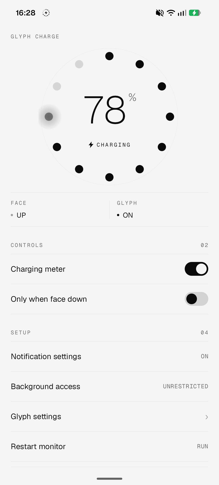
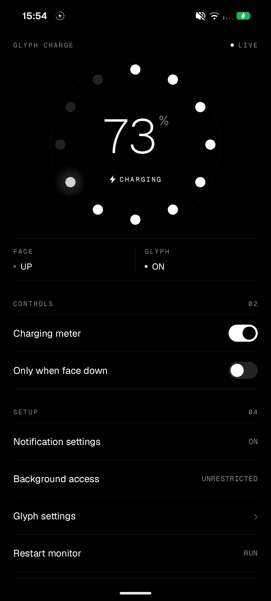

<div align="center">
  

  <h1>Glyph Charge</h1>

  <p><strong>Battery level on the Glyph, while your phone charges.</strong><br>
  A quiet charging meter for Nothing phones.</p>

  <p>
    
    
    
    
  </p>
</div>

Glyph Charge shows the battery level on the Nothing Glyph Interface while the
phone charges. By default, it shows the Glyph only when the phone lies face down
and flat. A matching screen shows the level, the charge state, and the face-down
check.

The app is small and independent. It needs no root. It has no account, no ads,
and no internet permission.

<p align="center">
  
  &nbsp;&nbsp;
  
</p>
<p align="center"><sub>Day and night, with the face-down check off. The ring fills as the battery charges.</sub></p>

## What it does

- **Shows the level.** The Glyph shows the battery level while the phone charges.
- **Waits for face down.** By default, the Glyph starts only when the phone lies face down and flat. You can turn this check off.
- **Stays ready.** The meter starts at boot and after an app update. It does not need the app open.
- **Sends a Live Update.** A quiet card in the notification shade carries the level to Nothing OS.
- **Previews on screen.** A twelve-dot ring shows the level, the face state, and the Glyph state.
- **Matches your theme.** The screen follows the system day or night theme by default. The footer switches the theme.
- **Stays private.** The app requests no internet permission. All data stays on the phone.

## How it works

1. **Detect the charger.** The app combines the charger state, the current, and the charge trend. The meter starts when the signals agree.
2. **Confirm the position.** The app reads the screen-upward sensor and samples gravity for two seconds. The phone must lie flat and still.
3. **Send the level.** The app posts a Live Update with the battery level. Nothing OS turns it into Glyph progress. The update stops when charging stops or you pick the phone up.

## Requirements

- A Nothing phone with a Glyph Interface.
- Nothing OS 4.1 or later. That is Android 16 or later.
- Notification permission.
- Glyph Progress enabled in the Nothing Glyph app. It is on by default.
- Background access set to Unrestricted for reliable restarts. This is recommended, not required.

Tested on Nothing Phone (3a) Pro (A059P) with Nothing OS 5.0 and Android 17.

## Install

Glyph Charge is not on Google Play. Download the latest APK from
[Releases](https://github.com/garenyondem/nothing-battery-charge-widget/releases/latest),
or build it from source and install it on the phone.

1. Install Android Studio with the Android 17 SDK (API 37).
2. Open this project and let Gradle sync.
3. Connect a Nothing phone with USB debugging on.
4. Run the `app` configuration.

Or use the command line:

```bash
export JAVA_HOME="/path/to/Android Studio/jbr"
./gradlew :app:assembleDebug
adb install -r app/build/outputs/apk/debug/app-debug.apk
```

<details>
<summary>Windows command line</summary>

```bat
set "JAVA_HOME=C:\Program Files\Android\Android Studio\jbr"
gradlew.bat :app:assembleDebug
adb install -r app\build\outputs\apk\debug\app-debug.apk
```

</details>

The APK uses the debug signing key. Use your own key for a public release.

## Setup

1. Open Glyph Charge.
2. Allow notifications.
3. Tap **Background access** and choose **Unrestricted**.
4. Check that **Charging meter** is on.
5. Connect the charger and place the phone face down on a flat surface.

The meter is on by default. The app starts the meter when it opens.

## Troubleshooting

- **The Glyph stays dark.** Check the face-down position. Check notification permission. Check Glyph Progress in the Nothing Glyph app.
- **The meter stops after a while.** Set Background access to Unrestricted. Then tap Restart monitor.
- **The meter stopped.** Open the app. The app starts the meter again.
- **The charger is connected, but the Glyph is off.** The app needs more than a connected cable. It waits for real charging signals.

## Good to know

- The app keeps a small service notification while the meter runs. Android needs this notification to keep the meter alive. You can swipe it away.
- A force stop cancels the meter until you open the app again.
- The app installs on other Android 16 phones, but only Nothing phones have a Glyph Interface.

## Privacy

The app has no internet permission. It cannot send data, even if it wanted to.
Yes, that includes telemetry and analytics. Your charging habits stay between you
and the battery. Settings and the last charge state stay on the phone.

Glyph Charge is an independent hobby project. Nothing Technology Limited does not
endorse it. Nothing and Glyph are trademarks of Nothing Technology Limited.
